<div align="center">



# BSIT-2106 Class Links

*A lightweight, centralized class portal for BSIT-2106 students.*

</div>

BSIT-2106 Class Links is a static web portal that brings together class schedules, upcoming assignments, and campus events in one accessible place. It is driven by simple JSON data files so updates can be made without touching application code.

> [!NOTE]
> All assignment and event data is stored in `assignments.json` and `events.json` at the repository root.

## Features

- **Assignments Tracker** — Displays current coursework and deadlines loaded from `assignments.json`.
- **Events Calendar** — Lists upcoming class and campus events from `events.json`.
- **Zero-Build Static Hosting** — Pure HTML, CSS, and JavaScript that runs directly in any browser or static host (e.g., GitHub Pages).

## Project Structure

```text
BSIT-2106-CLASS-LINKS/
├── index.html          # Main class portal interface
├── assignments.json    # Assignment listings and deadlines
├── events.json         # Class and campus events
└── banner.svg          # Animated repository banner
```

## Getting Started

1. Clone the repository:
   ```bash
   git clone https://github.com/bitancutiepie/BSIT-2106-CLASS-LINKS.git
   cd BSIT-2106-CLASS-LINKS
   ```
2. Open `index.html` in your browser, or serve it with any static file server:
   ```bash
   npx serve .
   ```
